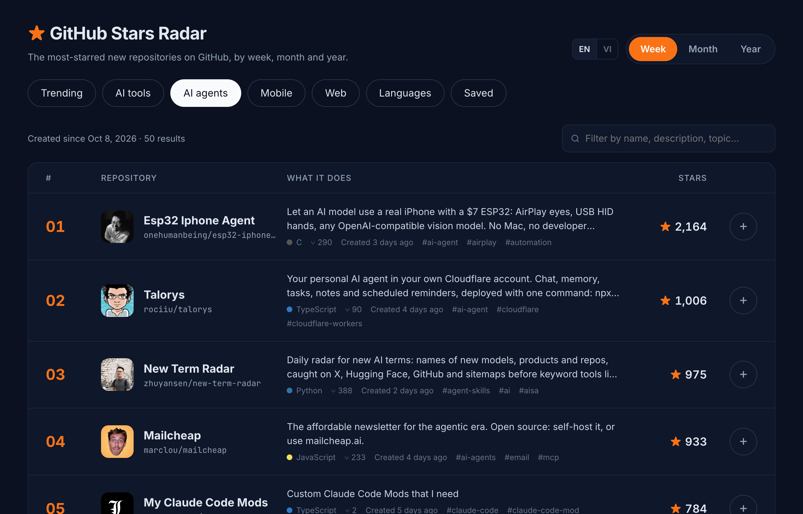
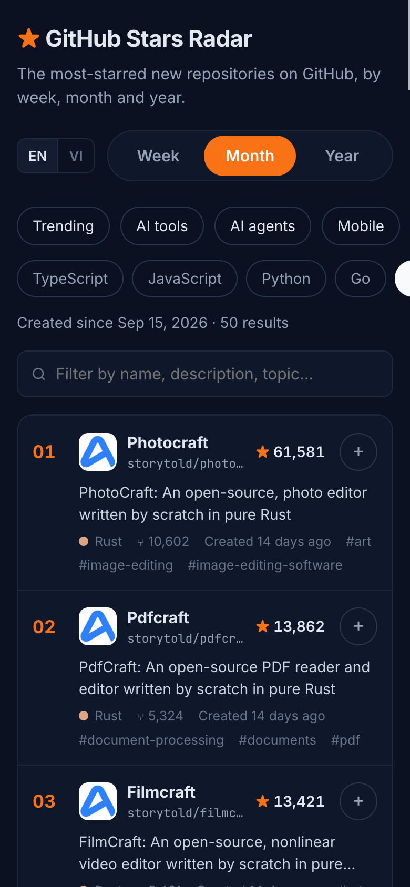
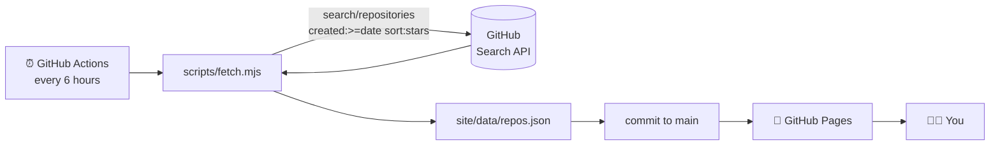

<div align="center">

# ⭐ GitHub Stars Radar

**The most-starred new GitHub repositories of the week, month and year, in one place.**

AI tools · AI agents · Mobile · Web · 14 programming languages

[](https://dab246.github.io/github-stars-radar/)

[](https://github.com/dab246/github-stars-radar/actions/workflows/update.yml)
[](https://github.com/dab246/github-stars-radar/commits/main)
[](https://github.com/dab246/github-stars-radar/stargazers)
[](https://github.com/dab246/github-stars-radar/forks)
[](LICENSE)
<br>
[](CONTRIBUTING.md)
[](https://github.com/dab246/github-stars-radar/issues?q=is%3Aopen+label%3A%22good+first+issue%22)


[Live site](https://dab246.github.io/github-stars-radar/) ·
[Report a bug](https://github.com/dab246/github-stars-radar/issues/new?template=bug_report.yml) ·
[Suggest a category](https://github.com/dab246/github-stars-radar/issues/new?template=category_request.yml) ·
[Contribute](CONTRIBUTING.md)

<br>

<table>
  <tr>
    <td width="72%"></td>
    <td width="28%"></td>
  </tr>
</table>

</div>

## Contents

- [Why](#why)
- [Features](#features)
- [Categories](#categories)
- [How it works](#how-it-works)
- [Run it locally](#run-it-locally)
- [Project structure](#project-structure)
- [Contributing](#contributing)
- [Contributors](#contributors)
- [Star history](#star-history)
- [License](#license)

## Why

GitHub Trending shows the last few days and mixes old and new projects. **GitHub Stars Radar** answers one question: *which repositories created recently got the most stars?* You can look by week, month or year, and narrow down to the area you care about.

## Features

| | |
|---|---|
| 📅 **Week / Month / Year** | Repositories created in the last 7, 30 or 365 days, ranked by stars |
| 🗂️ **Categories** | AI tools, AI agents, mobile, web, plus 14 languages |
| 🔎 **Instant filter** | Search by name, description, topic or language |
| ➕ **Save for later** | Keep a personal list in the *Saved* tab (stored in your browser) |
| 🌐 **English / Tiếng Việt** | Switch the interface language from the header |
| 🔗 **Shareable views** | Every view has its own link, e.g. [`#/month/lang/rust`](https://dab246.github.io/github-stars-radar/#/month/lang/rust) |
| 📱 **Responsive** | Table on desktop, compact cards on phones |
| 🔄 **Always fresh** | GitHub Actions refreshes the data every 6 hours |

## Categories

| Category | Matches repositories with |
|---|---|
| 🔥 **Trending** | everything |
| 🧠 **AI tools** | topics `llm` `ai` `generative-ai` `machine-learning` `mcp` `chatgpt` |
| 🤖 **AI agents** | topics `ai-agent` `ai-agents` `agents` `agentic-ai` `multi-agent` `claude-code` |
| 📱 **Mobile** | topics `android` `ios` `flutter` `react-native` `swiftui` `jetpack-compose` |
| 🌍 **Web** | topics `react` `nextjs` `vue` `svelte` `frontend` `tailwindcss` `web` |
| 💻 **Languages** | TypeScript · JavaScript · Python · Go · Rust · Java · Kotlin · Swift · Dart · C++ · C# · PHP · Ruby · Zig |

Missing something? [Suggest a category or language](https://github.com/dab246/github-stars-radar/issues/new?template=category_request.yml). It is usually a one-line change.

## How it works



- `scripts/fetch.mjs` runs one search per topic or language and per period. It merges the results and keeps the top 50 of each list. The search API cannot OR topics together, which is why it runs one query per topic.
- GitHub does not expose how many stars a repository gained in a given week. So *top of the week* means the most-starred repositories **created** in the last 7 days. Month and year work the same way with 30 and 365 days.
- The site is plain HTML, CSS and JavaScript: no framework, no bundler, no build step.

## Run it locally

Requirements: Node.js 18+ and, optionally, the [GitHub CLI](https://cli.github.com/) for a token.

```bash
git clone https://github.com/dab246/github-stars-radar.git
cd github-stars-radar

# 1. Fetch fresh data (about 5 minutes because of the search rate limit)
GITHUB_TOKEN=$(gh auth token) node scripts/fetch.mjs

# 2. Serve the static site
python3 -m http.server -d site 8000   # open http://localhost:8000
```

> [!TIP]
> Only working on the UI? Skip step 1. `site/data/repos.json` is already committed.

## Project structure

```text
.
├── .github/workflows/update.yml   # refresh data every 6h + deploy to Pages
├── scripts/fetch.mjs              # GitHub Search API → site/data/repos.json
└── site/
    ├── index.html                 # page shell
    ├── styles.css                 # design tokens + responsive layout
    ├── app.js                     # rendering, filters, saved list, i18n
    └── data/repos.json            # generated data (do not edit by hand)
```

## Contributing

Contributions of every size are welcome, from fixing a typo to adding a new category. Ideas to get started:

- 🗂️ **Add a category or language.** Add an entry to `CATEGORIES` / `LANGUAGES` in `scripts/fetch.mjs` and a label to `I18N` in `site/app.js`.
- 🌐 **Add a translation.** Copy the `en` block in `I18N` and translate it.
- 🎨 **Improve the UI.** Light theme, sorting by forks, a "new this week" badge…
- 🐛 **Fix a bug** or improve accessibility.

Read the **[contributing guide](CONTRIBUTING.md)** for the workflow, and browse the [good first issues](https://github.com/dab246/github-stars-radar/issues?q=is%3Aopen+label%3A%22good+first+issue%22).

## Contributors

Thanks to everyone who helps make this better 💛

<a href="https://github.com/dab246/github-stars-radar/graphs/contributors">
  
</a>

## Star history

If this project helps you discover something cool, please **give it a ⭐**. It helps others find it too.

<a href="https://star-history.com/#dab246/github-stars-radar&Date">
  <picture>
    <source media="(prefers-color-scheme: dark)" srcset="https://api.star-history.com/svg?repos=dab246/github-stars-radar&type=Date&theme=dark">
    
  </picture>
</a>

## License

[MIT](LICENSE). Repository data comes from the public [GitHub REST API](https://docs.github.com/en/rest/search/search#search-repositories) and belongs to the respective owners.
